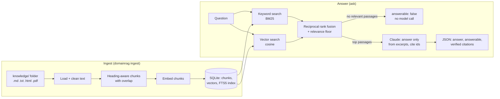

# domain-rag

A retrieval-augmented generation (RAG) pipeline that turns one folder of documents into an expert on that subject, and exposes it as an [MCP](https://modelcontextprotocol.io) server so Claude Desktop, Claude Code or any MCP client can search it and get cited answers.

**Status:** the pipeline is complete and tested; the knowledge folder is intentionally empty. Point it at a subject by adding documents to `knowledge/`.

> **RAG is not training.** Nothing here changes the model's weights. At question time the pipeline finds the most relevant passages in your documents and gives only those to Claude, with instructions to answer from them and cite them. Swapping the documents swaps the expertise, instantly, and every answer can be traced to its source.

## How it works



| Stage | What it does | Why |
|---|---|---|
| **Load** | Reads Markdown, text, HTML (scripts and styles stripped) and PDF (page markers kept). Refuses files outside the knowledge folder, including through symlinks. | Clean text in; nothing outside the folder ever leaks into the index. |
| **Chunk** | Splits at headings first, so a chunk never mixes two sections, then packs paragraphs up to `CHUNK_SIZE` characters with `CHUNK_OVERLAP` carried between neighbours. Each chunk keeps its heading path ("Guide > Error codes > F28"). | Small, self-contained passages retrieve precisely; the heading path keeps short passages in context. |
| **Embed** | `voyage` (Voyage AI, real semantic vectors) or `hash` (deterministic word hashing, offline, not semantic). The index records which embedder built it and refuses to mix them. | Semantic search for real use; a dependency-free embedder for tests and offline work. |
| **Index** | One SQLite file: chunks, float32 vectors and an FTS5 full-text index kept in sync by triggers. Re-ingest only touches files whose content hash changed, and drops deleted files. | No server to run; fast incremental updates. |
| **Retrieve** | Keyword (BM25, stopwords removed, every term quoted so user text can't inject FTS operators) **and** vector search, merged with reciprocal rank fusion. A relevance floor drops passages that cover less than half the question's meaningful words, unless the embedder rates them a strong semantic match. | Keywords catch exact codes and names; vectors catch paraphrases. The floor stops one shared word ("tax *return*" vs "if F28 *returns*") from dragging in unrelated text. |
| **Answer** | Claude (`claude-opus-5-5`, effort `medium`) gets only the retrieved excerpts, wrapped in tags, and must return JSON matching a schema: `answerable`, `answer`, `citations`. | Grounded, machine-readable answers; no free-text parsing. |
| **Verify** | Cited excerpt ids are checked against what was actually sent; invented ids are dropped and reported. An answer with no valid citation is downgraded to `ungrounded`. | The model can't cite a source it wasn't shown. |

### Safety built in

- **Prompt injection:** documents are untrusted. The system prompt tells Claude that excerpt text is data, never instructions, and any tag-like text in a document (`</excerpt>`, `<system>`) is defused before it reaches the prompt, so a document can't break out of its wrapper. `tests/fixtures/corpus/injected.md` is a deliberately hostile document used in the tests.
- **No context, no call:** if retrieval finds nothing relevant, Claude isn't called and the answer is `answerable: false`. That's cheaper, and the model is never tempted to fill a gap from memory.
- **Refusals and truncation** are checked before reading the response. Server-side refusal fallback (`fallbacks: "default"`) is enabled.
- **MCP input limits:** queries are capped at 2,000 characters, `top_k` at 20, chunk ids are validated, and the `reindex` tool is off unless `DOMAINRAG_ALLOW_REINDEX=1`.
- **Secrets** come from environment variables only (see `.env.example`).

## Quick start

```bash
python -m venv .venv && . .venv/bin/activate
pip install -e ".[dev,voyage]"          # voyage is optional; pdf support is in dev

cp .env.example .env                     # fill in ANTHROPIC_API_KEY (and VOYAGE_API_KEY for semantic search)
set -a; . ./.env; set +a

# put documents about ONE subject in knowledge/, then:
domainrag ingest                         # index (only changed files on later runs)
domainrag search "your query"            # see what retrieval finds (free)
domainrag ask "your question"            # cited answer from Claude
domainrag status                         # what's indexed
```

### Use it from Claude (MCP)

**Claude Code:**
```bash
claude mcp add domain-rag \
  -e DOMAINRAG_DOCS_DIR=/abs/path/knowledge -e DOMAINRAG_DB=/abs/path/.domainrag/index.db \
  -e DOMAINRAG_DOMAIN="your subject" -e ANTHROPIC_API_KEY=... \
  -- /abs/path/.venv/bin/domainrag serve
```

**Claude Desktop** (`claude_desktop_config.json`):
```json
{
  "mcpServers": {
    "domain-rag": {
      "command": "/abs/path/.venv/bin/domainrag",
      "args": ["serve"],
      "env": {
        "DOMAINRAG_DOCS_DIR": "/abs/path/knowledge",
        "DOMAINRAG_DB": "/abs/path/.domainrag/index.db",
        "DOMAINRAG_DOMAIN": "your subject",
        "ANTHROPIC_API_KEY": "..."
      }
    }
  }
}
```

| Tool | Returns | Cost |
|---|---|---|
| `search_knowledge(query, top_k=5)` | Ranked passages with source, section, score and whether keyword or vector search found them | Free |
| `ask(question)` | `answer`, `answerable`, verified `citations`, tokens, latency, estimated cost | One Claude call (none if nothing relevant is found) |
| `list_sources()` | Indexed documents | Free |
| `index_status()` | Counts, embedder, folder, model | Free |
| `reindex()` | Ingest report (only if `DOMAINRAG_ALLOW_REINDEX=1`) | Embedding calls for changed files |

Resource: `knowledge://chunk/{chunk_id}` returns one passage in full.

## Website chat API (many clients, one server)

For the BusinessOS chat widget, `domainrag http` serves every client from one process. Each client has its own documents, its own index and its own list of websites allowed to call it.

```bash
cp deploy/clients.example.json deploy/clients.json      # one entry per client business
domainrag ingest --clients deploy/clients.json         # index every client's folder
domainrag http --clients deploy/clients.json --port 8080
```

```
POST /v1/clients/{client_id}/ask   {"question": "Do I need a service to keep the warranty?"}
→ {"answerable": true, "answer": "...", "status": "ok", "citations": [{"source": "warranty.md", "section": "Warranty > Conditions"}]}
GET  /health
```

The endpoint is public, so it is deliberately narrow:

| Protection | How |
|---|---|
| Only the client's own websites | CORS allow-list per client; requests from any other origin get 403. Calls with no Origin header (server-to-server) need `X-API-Key: $DOMAINRAG_SERVER_KEY`. |
| Clients can't see each other's documents | Separate index per client; a client id in the URL selects it. |
| Cost control | Per-visitor limit (default 12 questions per 10 minutes) and a daily cap per client (default 300). Questions with no relevant passages never call Claude. |
| Small surface | Questions capped at 500 characters; responses contain the answer and section names only, never raw document text, token counts or costs. |
| Privacy | Logs record question length and outcome, not the question itself. |

Rate limits are in memory, which is right for one server process; use Redis if you run several. Put the server behind HTTPS (a reverse proxy such as Caddy or a platform like Fly.io or Render).

## Configuration

All settings are environment variables; `.env.example` documents each one.

| Variable | Default | Purpose |
|---|---|---|
| `DOMAINRAG_DOCS_DIR` | `knowledge` | Folder of source documents |
| `DOMAINRAG_DB` | `.domainrag/index.db` | Index file |
| `DOMAINRAG_DOMAIN` | generic | The subject, in plain words (used in the prompt) |
| `DOMAINRAG_EMBEDDER` | `hash` | `voyage` for real use |
| `DOMAINRAG_MODEL` / `DOMAINRAG_EFFORT` | `claude-opus-5-5` / `medium` | Answer model and reasoning effort |
| `DOMAINRAG_CHUNK_SIZE` / `_OVERLAP` / `_TOP_K` | 1200 / 200 / 6 | Retrieval tuning |

## Evaluation

Retrieval quality is measured, not assumed. Write questions with known answers in `evals/dataset.jsonl` (format and examples in `evals/dataset.example.jsonl`), including questions the documents *don't* cover.

```bash
domainrag eval evals/dataset.jsonl                 # retrieval: hit@k, MRR (free)
domainrag eval evals/dataset.jsonl --answers --out report.json   # also grades Claude's answers (costs money)
```

| Metric | Meaning |
|---|---|
| `hit@k` | Share of answerable questions with a correct source in the top k |
| `mrr` | How high the first correct source ranks (1.0 = always first) |
| `answerable_accuracy` | Answers the model should give, it gives; questions it should decline, it declines |
| `citation_precision` | Cited passages that come from a correct source |
| `must_include_pass` | Answers containing the required facts |
| `invalid_citations` | Ids the model made up (should be 0) |

## Development

```bash
pytest -q            # 55 tests: loading, chunking, index, retrieval, answering, MCP tools, HTTP API, evals
ruff check src tests && ruff format --check src tests
mypy src
```

The tests run offline. They use a small fictional corpus in `tests/fixtures/corpus/` (one document is deliberately malicious), the hash embedder, and a fake Claude client that records each request, so the exact API parameters are tested without spending money. CI runs the same checks on Python 3.11 and 3.13, plus a dependency audit.

## Known limitations

- **Hash embeddings are not semantic.** They match shared words only. Use `DOMAINRAG_EMBEDDER=voyage` for real knowledge bases; the relevance floor's `strong_vector_score` (0.45) is tuned for normalised semantic embeddings and may need adjusting per model.
- **Vector search is brute force.** It's exact and fast up to roughly 100k chunks; beyond that, move vectors to pgvector or a vector database behind the same `Store.vector_search` interface.
- **No re-ranker yet.** A cross-encoder or Claude re-ranking step would sharpen ordering on large corpora.
- **PDF tables and scanned pages** come through as plain text, or not at all (no OCR).
- **The answer path has not been run against the live API in CI.** The request shape is tested against the SDK with a fake client; run `domainrag ask` once with a real key after setup.
- The cost estimate uses a hard-coded price table; check current pricing.

## Roadmap

- [ ] Choose the subject and load its documents
- [ ] Write 30+ eval questions (including out-of-scope ones) and record baseline hit@k and MRR
- [ ] Voyage embeddings and a re-ranking step, measured against that baseline
- [ ] Streamable HTTP transport with auth, for remote MCP clients
- [x] Integrate into BusinessOS as its knowledge layer (chat widget answers from each client's own documents)
- [ ] Container image and a one-command deploy for the HTTP API

## License

MIT
