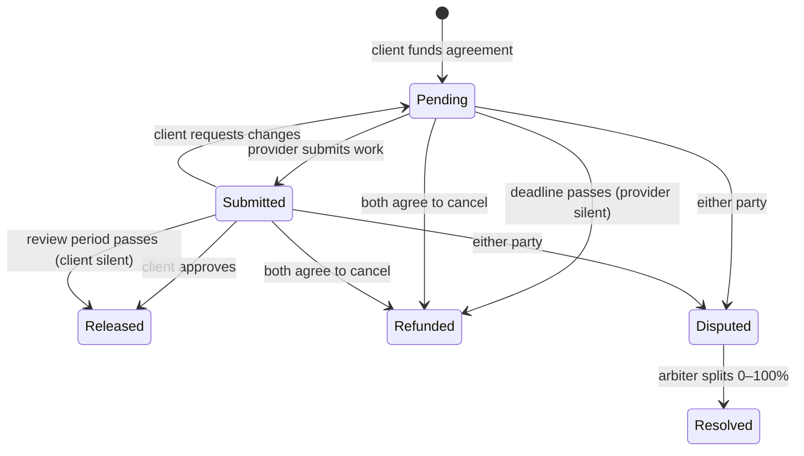

# Onchain Escrow

Milestone-based escrow for freelance and agency work, in Solidity. A client locks the full budget up front, the provider is paid milestone by milestone as work is approved, and a neutral arbiter settles disputes. Both sides are protected from the other going silent.

> **Not audited. Testnet only.** This code has strong automated tests but no independent security review. Do not use it with real funds.

## Why this exists

Freelance and agency work has a trust gap. Clients don't want to pay before delivery; providers don't want to deliver before payment. Platforms solve it by holding the money and charging 10–20%. This contract holds the money instead, with rules both parties can read before they sign.

## How it works



| Role | Can do |
|---|---|
| **Client** | Create and fund the agreement, approve or reject submissions, claim refunds for milestones not delivered by the deadline, raise disputes, agree to cancel. |
| **Provider** | Submit milestones, claim payment if the client doesn't respond within the review period, raise disputes, agree to cancel. |
| **Arbiter** | Split a *disputed* milestone between the parties. Can't touch anything else and can never receive funds. |

### Design decisions

- **Pull payments.** Settling a milestone only credits a balance; each party calls `withdraw`. A recipient who can't receive tokens (for example a USDC-blacklisted address) therefore can't block the other party's refund. There's a test for exactly this case.
- **Neither side can hold the other hostage.** A silent client can't freeze delivered work (review-period timeout), and a silent provider can't freeze the budget (deadline refund).
- **Submitted work is protected.** The deadline refund only applies to milestones that were never submitted.
- **Cancellation needs both parties.** Mutual cancel refunds everything not yet settled; disputed milestones stay with the arbiter.
- **One contract, many agreements.** There's no factory, so there's less to deploy and less to review.
- **Plain ERC-20s only.** Fee-on-transfer and rebasing tokens are rejected at funding time because they would break the accounting.
- **Accounting you can check on-chain:** for every token, `balanceOf(escrow) == totalLocked + totalWithdrawable`.

## Tests

```
forge test
```

The last run had 40 tests, all passing:

| Suite | What it covers |
|---|---|
| `MilestoneEscrow.t.sol` (17) | Every lifecycle path: happy path, reject and resubmit, both timeouts, disputes, mutual cancel, role checks |
| `Guards.t.sol` (7) | Every revert guard (invalid state, wrong caller, out-of-range index, overflow) |
| `MilestoneEscrow.fuzz.t.sol` (4) | Random milestone sets, random arbiter splits, review-period boundary to the second, random callers. 1,000 runs locally, 10,000 in CI |
| `Adversarial.t.sol` (8) | Re-entrant token on `withdraw` and `fund`, fee-on-transfer token, blacklisted recipient, a malicious token trying to drain other tokens, double-release across paths, isolation between agreements |
| `invariant/` (4 invariants) | Random sequences of all 12 actions across 3 clients, 3 providers and an arbiter (256 runs × 64 calls locally, 256 × 500 in CI) |

**The invariants:**
1. The escrow's token balance always equals locked plus withdrawable funds.
2. Total deposited minus total withdrawn equals what the escrow holds.
3. Per agreement, the settled amount matches the milestone states, and an agreement is closed exactly when everything is settled.
4. The arbiter never accrues a balance.

The invariant handler counts the actions that actually execute, not just the calls it makes. A long run (3 × 2,000 calls) exercised every path: 87 fundings, 96 submissions, 60 disputes, 60 resolutions, 37 timeout releases and 82 deadline refunds, all with zero reverts.

**Coverage of `src/MilestoneEscrow.sol`** (`forge coverage --ir-minimum`): 100% of lines, statements, branches and functions. Coverage shows the code ran. It doesn't prove the code is correct, which is why the invariants and adversarial tests exist.

## Run it

Requires [Foundry](https://getfoundry.sh).

```bash
git clone --recurse-submodules https://github.com/boujeepants24/onchain-escrow
cd onchain-escrow
forge build
forge test                      # all suites
FOUNDRY_PROFILE=ci forge test   # heavier fuzz/invariant settings used in CI
forge coverage --ir-minimum
```

### Deploy to a testnet

The script deploys the escrow and a mintable test stablecoin. It refuses to run on Ethereum mainnet.

```bash
cast wallet import deployer --interactive        # stores the key encrypted; never put keys in .env
forge script script/Deploy.s.sol:Deploy \
  --rpc-url $SEPOLIA_RPC_URL --account deployer --broadcast --verify
```

| Variable | Purpose |
|---|---|
| `SEPOLIA_RPC_URL` | RPC endpoint for the testnet you deploy to |
| `ETHERSCAN_API_KEY` | Only needed for `--verify` |

## Security

See [SECURITY.md](SECURITY.md) for the threat model, how each threat is tested, and known limitations.

## Roadmap

- [x] Contract, unit, fuzz, adversarial and invariant tests, CI
- [ ] Next.js + TypeScript frontend (create, fund, submit, approve, dispute, withdraw) using viem and wagmi
- [ ] Sepolia deployment with a verified contract and a recorded walkthrough
- [ ] Static analysis with Slither, with results documented
- [ ] Optional: EIP-712 signed agreements so the provider explicitly accepts terms on-chain

## License

MIT
