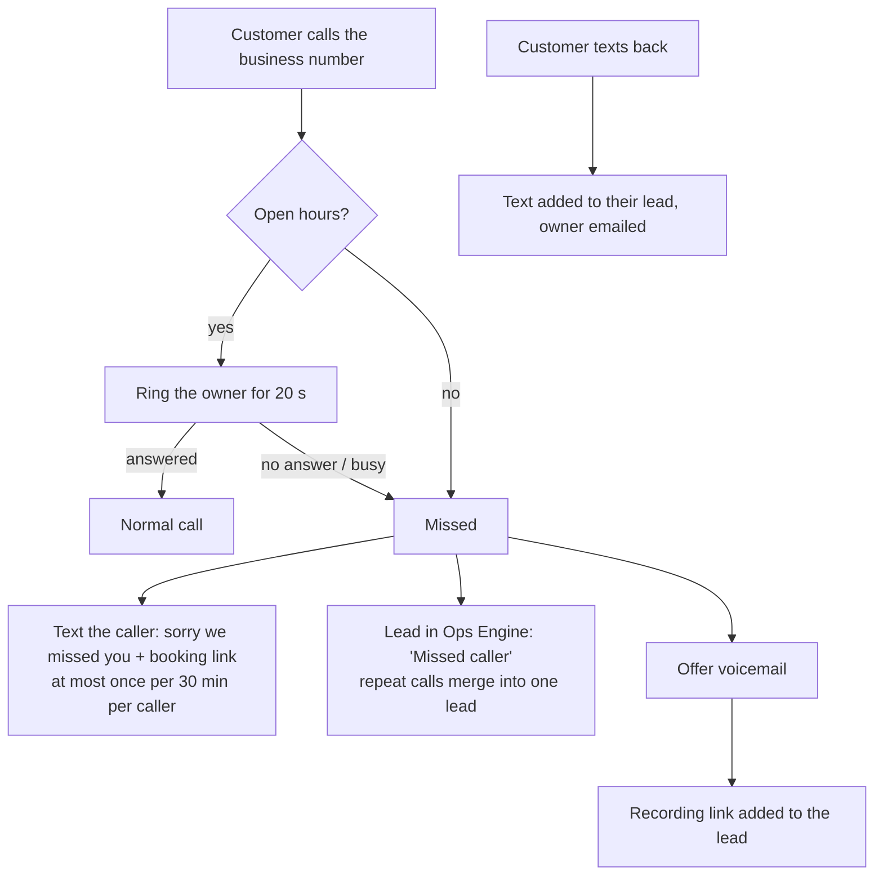

# Comms Gateway

The phone and SMS front door for BusinessOS. When a client's customer calls and nobody picks up, the customer gets a text with the booking link within seconds. The missed call becomes a lead in the client's Ops Engine, and any reply or voicemail is attached to it. It works internationally through Twilio.

## What happens on a call



| Situation | What the customer gets | What the business gets |
|---|---|---|
| Owner answers | A normal call | Nothing extra |
| Owner misses it, open hours | A message saying a text is on its way, then the text and a voicemail option | A "Missed caller" lead in the jobs app, plus an email |
| Out of hours | The closed message, then the text and a voicemail option (the owner's phone doesn't ring unless `forward_after_hours` is set) | Same, marked as an after-hours call |
| Rings 3 times in 10 minutes | One text, not three | One lead, noted "Called again" |
| Hidden number | No text (nowhere to send it) | The lead is still logged |
| Replies to the text | Nothing automatic yet | The reply is added to their lead and emailed to the owner |
| Texts STOP or HELP | Twilio handles the opt-out | Not forwarded as an enquiry |

## Reliability and security

- **Every request must be signed by Twilio** (`X-Twilio-Signature`). Unsigned, forged or tampered requests get 403 and trigger nothing.
- **No lead is lost when Google is down.** Events the Ops Engine doesn't accept go to a disk outbox and are retried every 5 minutes for 24 hours. `/health` shows how many are waiting.
- **The caller is never kept waiting on Google.** The voice response goes back to Twilio first; the text and the Ops Engine update run afterwards.
- **A failed text never loses the lead**, and a failed lead never stops the text.
- **Phone numbers are masked in logs** (`+44•••777`), and message bodies are not logged.
- **Config is validated at startup:** numbers must be international (E.164) format, the owner's phone can't equal the business number (which would loop calls), the Ops Engine URL must be https, and timezones must exist.

## Set up (one gateway serves all clients)

1. **Deploy the gateway** somewhere with a public https address (Fly.io, Render, Railway or a small VPS behind Caddy):
   ```bash
   pip install -e .
   cp .env.example .env               # Twilio credentials and COMMS_PUBLIC_URL
   cp deploy/clients.example.json deploy/clients.json
   set -a; . ./.env; set +a
   commsgateway --clients deploy/clients.json --host 0.0.0.0 --port 8000
   ```
2. **For each client, in the Twilio console:**
   - Buy a local number in their country, or port their existing number to Twilio. Alternatively, keep their number and set it to forward to the Twilio number when unanswered.
   - Voice → "A call comes in" → Webhook `POST https://<COMMS_PUBLIC_URL>/twilio/voice`
   - Messaging → "A message comes in" → Webhook `POST https://<COMMS_PUBLIC_URL>/twilio/sms`
3. **Add the client** to `deploy/clients.json` (their Twilio number, owner's mobile, Ops Engine URL, booking link, timezone, hours) and restart.
4. **Test it:** call the number and don't answer. You should get the text and see the lead in the jobs app. Then reply to the text and check it's attached to that lead.

### Country rules to check before going live

- **United States:** business texting from local numbers needs A2P 10DLC registration (brand + campaign) in the Twilio console, or toll-free verification. Unregistered texts are blocked. Allow 1–3 weeks.
- **Canada and Australia:** sender rules vary by number type; check Twilio's country guidelines.
- **UK / EU:** no registration for normal numbers. Messages to people who called you are service messages, but keep the opt-out line, and treat call data under GDPR (retention, deletion on request).
- **Voicemail:** the greeting tells callers they're leaving a message. If you later record live calls, disclosure and consent rules vary by country and US state.

Costs come from Twilio: a phone number (roughly $1–2 a month for a local number in many countries), plus per-minute call forwarding and per-message SMS charges. Check Twilio's pricing for each country.

## Development

```bash
pip install -e ".[dev]"
pytest -q          # 21 tests, all offline, with Twilio-signed requests
ruff check src tests && mypy src
```

The tests sign every request the way Twilio does, so signature checking is tested for real. A fake SMS sender and a fake Ops Engine record what would have been sent.

## Not built yet

- Automatic answers to inbound texts (the knowledge base already exists; this needs two-way WhatsApp/SMS with owner approval). This is next on the roadmap.
- An AI voice receptionist that answers instead of going to voicemail.
- WhatsApp text-back. WhatsApp needs a pre-approved message template for the first message to a caller, so it's added with the two-way inbox.
- Voicemail transcription.
